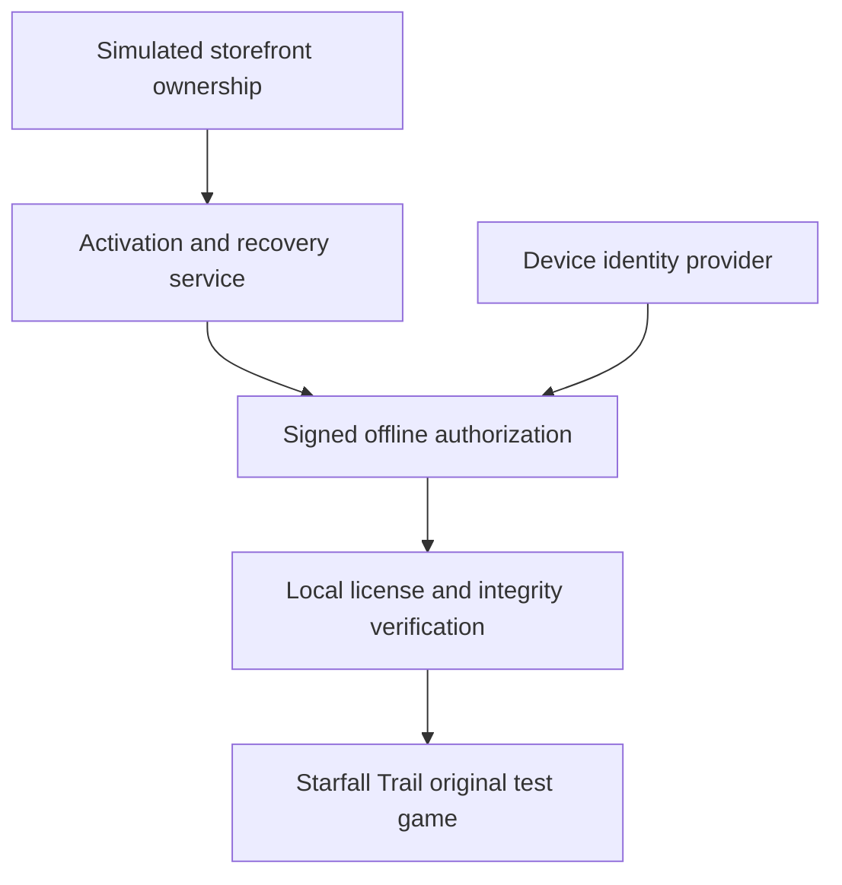

# Sentinel Research

**Independent cybersecurity and software engineering research | Experimental game licensing and DRM**

## Why Sentinel?

Commercial game protection must balance publishers' interest in preventing unauthorized use with players' interest in reliable access to purchased games. Sentinel explores whether a layered licensing architecture can improve that balance through offline authorization, optional hardware-backed credentials, recoverable device identities, supported modifications, and minimal performance overhead.

The project is an early-stage research prototype, not a commercial DRM product or a demonstrated replacement for Denuvo.

## Role of Starfall Trail

Starfall Trail is an original, internally developed research testbench, not a planned commercial game release. Sentinel is the primary research and engineering project. Game features, graphics, animation, and asset complexity are added only when they provide representative, reproducible workloads for authorization, integrity, compatibility, scalability, or performance experiments. Prioritize measurable CPU, GPU, memory, and asset-loading workloads over entertainment value or distribution. Maintain equivalent protected and developer-authorized unprotected benchmark configurations. There is no requirement to publish the game commercially.

## Research question

Can a hybrid game licensing architecture resist unauthorized credential copying while preserving offline single-player gameplay, accommodating hardware upgrades, and minimizing disruption for legitimate players?

## Architecture

Ownership, device identity, and local authorization are separate responsibilities. The prototype supports portable software credentials and an earlier Windows TPM-backed implementation. Real storefront integration is a future objective; the current storefront is simulated.

## Sentinel Adaptive (proposed)

A developer-side, AI-assisted maintenance pipeline would investigate reproducible defects using authorized test evidence, propose source corrections, validate them in isolation, and require human approval before signed releases. No AI model runs on the player's PC. Offline cracks cannot be universally detected or retroactively repaired. The research goal is to measure repair time, correctness, cost and regression risk, not to claim autonomous or uncrackable protection.

See [Sentinel Adaptive architecture](docs/sentinel-adaptive.md) and the [comparative DRM benchmark plan](benchmarks/README.md). Both are research proposals, not demonstrated features or performance gains.

## Development progress

| Version | Milestone | Evidence status |
| --- | --- | --- |
| V0.5 | Windows TPM enrollment, signed offline licenses, text adventure and supported mods | Initial same-PC identity separation pilot |
| V0.6 | Portable regression suite and stricter validation | Earlier sandbox development; detailed report not yet indexed here |
| V0.7 | Simulated storefront, enrollment and recovery | [35 expected integration outcomes](experiments/v0.7-storefront-recovery.md) |
| V0.8 | Original graphical exploration game with inventory, crafting and saves | [45 expected integration outcomes](experiments/v0.8-graphical-game-pilot.md) |
| V0.8.1–0.8.2 | Launcher, standalone packaging preparation and Windows build automation | Windows x64 compilation, 2/2 native tests, launcher packaging, and researcher-reported activation and offline relaunch on a physical Windows PC |
| V0.9 | Textured and animated 100 MB game workload, simulated one-click authorization | [51 expected integration and GUI outcomes](experiments/v0.9-textured-workload-and-storefront.md); Windows verification pending |
| V0.10 | Simplified launch and separate 3D OpenGL workload | [53 expected portable integration outcomes](experiments/v0.10-launch-and-opengl.md); actual Windows GPU testing pending |
| V0.11 | Synthetic purchases, refunds and isolated installation profiles | [63 expected integration outcomes](experiments/v0.11-synthetic-storefront.md); Windows GUI verification pending |
| V0.12 | Enrollment proof of possession and strict request validation | [75 expected integration and GUI outcomes](experiments/v0.12-enrollment-hardening.md); Windows verification pending |
| V0.13 candidate | Optional device-bound enrollment grant | Nine targeted checks; storefront integration and full regression pending. [Separate V0.12 50,000-account workload](experiments/v0.12-50k-activation-pilot.md) |
| V0.14 candidate | Optimized activation service and expanded integrity tests | [Matched 50,000-arrival tests](experiments/v0.14-burst-and-integrity.md); 78 expected integration outcomes, Windows verification pending |
| V0.15 candidate | Lab signing-key lifecycle and packaging validation | [11 Vault checks, 78 integration outcomes](experiments/v0.15-vault-foundation.md); Windows and production Vault pending |

Counts represent outcomes matching expectations, including documented weaknesses, not the number of attacks prevented.

## Findings and open questions

- The initial Windows pilot rejected authorization associated with a different device key on the same physical PC.
- Sandbox tests rejected several unauthorized license and protected-file changes with the verifier intact.
- A more complex graphical game provides a workload for compatibility and future performance experiments; complexity alone does not strengthen licensing.
- Complete portable software credentials remain copyable in the current prototype.
- Unlimited offline authorization cannot be immediately revoked while a device remains offline.
- Physical cross-device TPM testing, controlled performance comparisons, full executable tamper resistance, and production storefront integration remain open research tasks.

## Design principles

**Strong protection and player experience are joint design objectives.** Optional enhanced protection configurations may be evaluated when they provide a demonstrated security benefit, even if they introduce limited, measurable compatibility or performance costs. Minimize those costs, preserve automatic activation and ordinary offline play, provide accessible recovery, and disclose remaining tradeoffs before adoption. Avoid invasive monitoring, arbitrary lockouts and blanket virtualization restrictions. See the [protection configuration policy and separate player-impact disclaimer](docs/protection-configurations.md).

- Storefront-first experience: legitimate players download and press Play. Initial authorization should occur automatically using the existing storefront entitlement, with clear actionable errors when needed.
- No separate mandatory Sentinel launcher, account, manual activation code, developer tools, or player-hosted server. The V0.8.2 manual issuer and launcher are test infrastructure only.
- Offline gameplay after initial authorization, while required local credentials remain valid.
- Straightforward recovery for legitimate hardware changes.
- Supported community modifications.
- Minimal overhead and privacy-preserving operation.
- No mandatory virtualization blocking or invasive kernel-level monitoring.
- Reproducible tests, transparent limitations, and reviewed security updates.

These are design objectives, not guarantees demonstrated across commercial games.

## Research index

| Resource | Purpose |
| --- | --- |
| [Working research paper](research/paper-draft.md) | Background, methods and preliminary observations |
| [Development roadmap](docs/v1-roadmap.md) | Planned research and engineering milestones |
| [Publisher incentives and prior art](research/002-publisher-incentives-and-prior-art.md) | Existing approaches and commercial motivation |
| [Research protocol](research/protocol.md) | Hypotheses, controls and methodology |
| [Literature review](research/literature-review.md) | Technical and academic background |
| [Experiment register](experiments/README.md) | Initial pilot observations |
| [V0.7 storefront and recovery experiment](experiments/v0.7-storefront-recovery.md) | Ownership and recovery findings |
| [V0.8 graphical game experiment](experiments/v0.8-graphical-game-pilot.md) | Gameplay workload and authorization findings |
| [V0.8.2 Windows offline pilot](experiments/v0.8.2-windows-offline-pilot.md) | Physical PC activation and offline relaunch |
| [V0.9 textured workload and storefront pilot](experiments/v0.9-textured-workload-and-storefront.md) | Larger asset workload and automatic authorization |
| [V0.10 launch and OpenGL pilot](experiments/v0.10-launch-and-opengl.md) | Simplified launch and adjustable 3D benchmark |
| [V0.11 synthetic storefront pilot](experiments/v0.11-synthetic-storefront.md) | Zero-cost purchase and refund experiments |
| [V0.12 enrollment hardening](experiments/v0.12-enrollment-hardening.md) | Proof of possession and authorization regressions |
| [50,000-account activation pilot and Enhanced candidate](experiments/v0.12-50k-activation-pilot.md) | Authorization accuracy, throughput and tail latency; optional device-bound grant pilot |
| [V0.14 burst and integrity experiment](experiments/v0.14-burst-and-integrity.md) | Matched throughput, queue delay and intact-verifier integrity checks |
| [V0.15 Vault foundation](experiments/v0.15-vault-foundation.md) | Signing-key lifecycle, separation and build validation |
| [Sentinel Adaptive architecture](docs/sentinel-adaptive.md) | Proposed detection, diagnosis, reviewed correction and evaluation |
| [Comparative benchmark plan](benchmarks/README.md) | Matched DRM comparisons, performance and scalability methodology |
| [Research journal](journal/README.md) | Learning and reflections |
| [Research integrity and contributions](research/integrity.md) | Authorship, assistance and evidence practices |

## Current priorities

1. Prototype automatic first-launch authorization with a simulated storefront and measure player-facing steps, startup latency, failure recovery, and offline relaunch. Real Steamworks integration requires authorized access.
2. Verify a reproducible standalone Windows build and authorized first launch on a clean installation.
3. Independently reproduce the existing experiments, including physical-device and recovery tests.
4. Compare Sentinel-protected and equivalent unprotected workloads, then matched Steam DRM, Denuvo and other authorized configurations when available.
5. Evaluate credential portability and usability tradeoffs.
6. Prototype Sentinel Adaptive and compare AI-assisted maintenance against conventional diagnosis using controlled defect cases.

## Feedback and research integrity

Technical feedback on licensing design, experimental methodology, player experience and performance measurement is welcome through repository issues.

Testing is restricted to original owned software and synthetic credentials. Prototype development and documentation have involved AI assistance. The researcher records personal contributions and should independently reproduce and interpret results before academic submission. Engine source and private credentials are not published here. No claim of commercial anti-piracy effectiveness, independent replication, or superiority over competing products is made.
