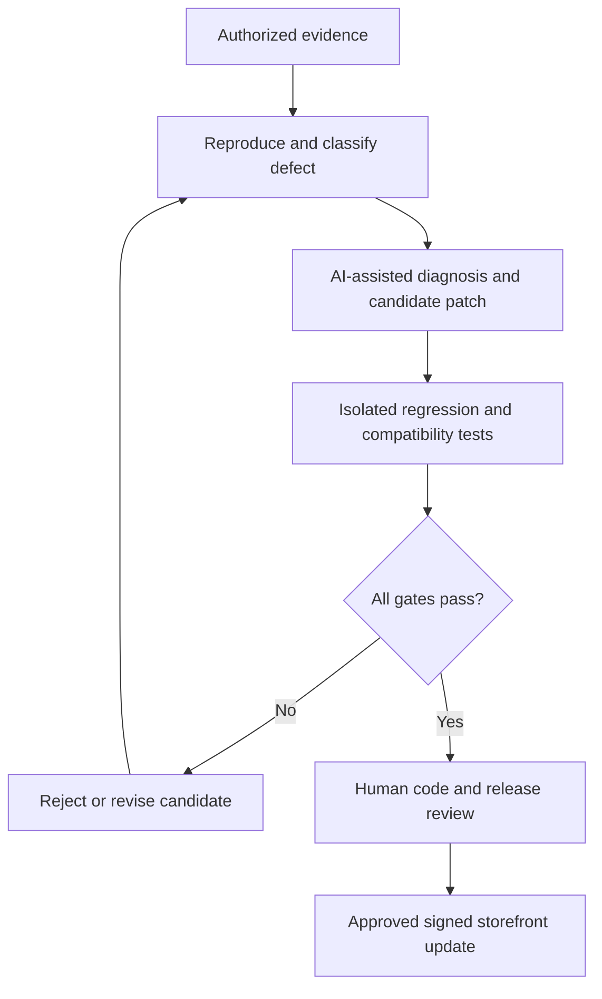

# Sentinel Adaptive: Developer-side security maintenance

Status: proposed architecture, November 24, 2026. Not yet implemented or validated.

## Research question

Can AI-assisted security maintenance reduce the time between discovering a reproducible authorization defect and releasing a validated correction, compared with a conventional developer-led process, without increasing player disruption or weakening existing security guarantees?

## 1. How does Sentinel know something has gone wrong?

An offline installation cannot reliably report that it has been cracked. A failed integrity check, abnormal server activity, or a security report is a signal for investigation, not proof of piracy. The proposed system uses authorized evidence:

- Repeatable adversarial tests of the original Starfall Trail game using synthetic entitlements.
- Regression tests for previously observed defects.
- Minimal, privacy-preserving activation-service diagnostics.
- Developer reports and responsible vulnerability disclosures from authorized researchers.

No piracy-site monitoring, player file scanning, hidden telemetry, or third-party circumvention is required. False positives must be investigated rather than automatically treated as wrongdoing.

## 2. How does it decide what to fix?

Record a defect's expected behavior, observed behavior, affected version, reproducible test case, and sanitized diagnostics. A developer-side analysis service may use an AI model to review the evidence and suggest a likely root cause and a candidate source change. If the evidence is insufficient, request further testing instead of guessing.

The proposed change must preserve license validity, offline gameplay, hardware recovery, supported mods, accessibility, and legitimate saves. A regression test must reproduce the defect before the proposed correction can be evaluated.

## 3. Where and when does AI run?

The analysis service runs on authorized developer infrastructure, not inside the game or on a customer's PC. An initial implementation can use the private engine repository and an isolated development or CI environment. A hosted model or local model can be evaluated later; cost and data handling must be measured. No model runtime is required on the player's computer.

Candidate triggers are a failed scheduled regression test, a new developer-approved vulnerability report, a relevant source change, or a failed candidate-fix validation. Normal offline gameplay triggers no AI work. The initial prototype is manually initiated and does not require a continuously running agent.

## 4. Proposed maintenance workflow

The analysis service should have least-privilege access to approved source and sanitized test evidence. It must not have production signing keys or authority to deploy automatically. Treat external reports as untrusted input. Human review, ordinary release signing, rollback planning, and a reviewed update mechanism remain mandatory. No autonomous rewriting of installed executables, intentional game disruption, or mandatory update for already-authorized offline play.

Offline copies cannot receive fixes until an update is installed. Sentinel cannot promise universal crack detection, retroactive repair, or guaranteed prevention of unauthorized use.

## 5. Evaluation methodology

Compare conventional developer-led diagnosis with AI-assisted diagnosis using the same controlled, preselected defect cases in the owned lab. Separate baseline and assisted trials, record model and source revisions, and report uncertainty and failed attempts. Avoid evaluating on cases used to tune the system where possible.

Measure:

- Time from defect discovery to reproducible diagnosis.
- Time to a candidate patch and to a validated, human-approved correction.
- Correct root-cause identification and successful repair rate.
- False-positive rate and unintended regressions.
- Human review effort, compute cost, and the number of attempted fixes.
- Offline launch, legitimate authorization, supported mod and gameplay reliability before and after the change.
- Startup and runtime performance compared with the pre-change build.

A candidate counts as successful only when it resolves the demonstrated defect and passes predeclared regression gates. Report negative outcomes, not merely successful examples. The first experiment should use ordinary parser, recovery, authorization and reliability defects in the original test game.

## 6. Implementation milestones

1. Define a versioned defect-report schema and regression register.
2. Build a reproducible, manually triggered test-and-diagnosis pipeline.
3. Add a restricted AI-assisted candidate generation stage in an isolated environment.
4. Introduce independent test gates and human-reviewed pull requests.
5. Evaluate repair time and correctness against conventional maintenance.
6. Demonstrate an approved signed update and rollback on the owned test game without invalidating legitimate offline access.

These milestones describe research objectives, not a working autonomous repair system. See the [benchmark plan](../benchmarks/README.md) for performance comparison design and the [development roadmap](v1-roadmap.md) for integration priorities.
